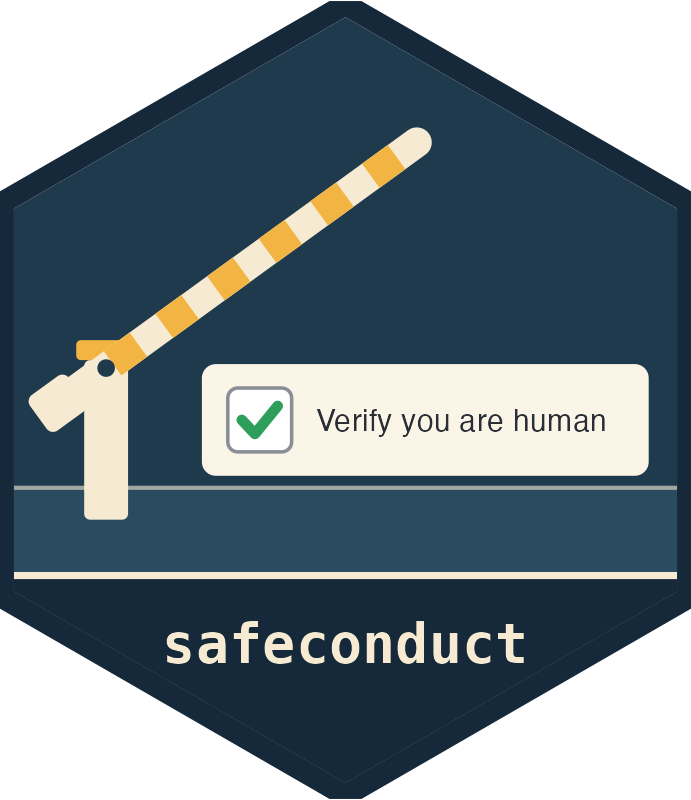

# safeconduct 

Fetch files and pages through a real browser when a plain request is refused.

Some servers refuse any request that does not come from a web browser.
Cloudflare, the common case, refuses in two ways: a browser check, a `403`
page that runs a script, sets a `cf_clearance` cookie and reloads; or a block,
a `403` page that says "Sorry, you have been blocked", because the rule is
about what the client looks like. `curl`, `download.file()` and friends never
get past either. A browser does, and this package lets a browser do what a
browser is allowed to do:

```r
safeconduct::fetch(
  "https://www12.statcan.gc.ca/census-recensement/2021/geo/sip-pis/rnf-frr/files-fichiers/lrnf000r21a_e.zip",
  "lrnf000r21a_e.zip")
```

If the server serves the file to a plain request, that is what happens and no
browser is involved. Otherwise a Chrome with a throwaway profile is opened on
the host, the check runs if there is one, and the file is downloaded: through
`curl` carrying the browser's clearance where the server accepts that, and in
the browser itself where it does not. A clearance `curl` can use is kept for
the rest of the R session, so later files from the host need no browser. A
file downloaded in the browser lands under `tempdir()` and is moved into
place when complete.

Nothing is simulated. When the check shows a "Verify you are human" box, the
window is brought to the front and waits up to two minutes for the person at
the screen to click it (it wants to stay in front until it is through), and
the browser is not disguised beyond dropping the word `Headless` from its
user-agent string, which some hosts refuse on that word alone. A download
that must run unattended cannot rely on this package where such a box is
shown, and a server that blocks the browser too is reported as such within
seconds.

Documentation, with the function reference and a getting-started vignette
that walks through two refused downloads, is at
<https://mountainmath.github.io/safeconduct/>.

## Pages and feeds

`read_page()` is `fetch()` for a page or a feed: the response comes back in
memory, shaped like `curl::curl_fetch_memory()`'s, by the same route.
`page_json()`, `page_text()` and `page_html()` parse it, taking the charset
from its headers and raising an HTTP error status; each also takes a URL, so
`page_html(url)` stands in for `rvest::read_html(url)`. For a feed read every
few minutes, keep one browser open on the host:

```r
s <- safeconduct::browser_session("https://results.vancouver.ca/")
r <- safeconduct::read_page("https://results.vancouver.ca/data/arearesults.json",
                            session = s)
safeconduct::page_json(r)
close(s)
```

A check the server asks for again meanwhile is passed and the read repeated;
a browser that has gone away is reopened at the next call.
`fetch(url, destfile, session = s)` downloads a file in the same browser.

## Windows

By default headless Chrome goes first, and a window is opened only when the
headless run ends on a check or a block, and only when there is a display to
show it on. `headed = TRUE` opens a window at once, `FALSE` never does, and
`useragent = NULL` keeps Chrome's own user-agent string; both arguments are
on every function that may open a browser. Some hosts run a second check at
the file's URL, which headless Chrome passes unclicked after about two
minutes where a window is through as soon as its box is clicked; the package
says so and waits, and `headed = TRUE` skips the wait. At the console, once a
host has been found to need a window, a tip says so, once per host and R
session.

## Prerequisites

* [Chrome or Chromium](https://www.google.com/chrome/), found by
  `chromote::find_chrome()`; set `CHROMOTE_CHROME` if it is somewhere
  unusual.
* A display, for checks that need a click. Without one Chrome runs headless.

`options(safeconduct.browser = FALSE)` never opens a browser.

## For package authors

Errors are classed under `safeconduct_error`: `safeconduct_unavailable` when
no browser can be opened here, `safeconduct_not_passed` when the check was
not passed in time or the server blocks the browser too, and
`safeconduct_download_error` when the transfer failed. A calling package can
catch these and turn them into instructions to download by hand.

`clearance(url)` returns the browser's user-agent string and cookies for a
host, and `clearance_handle(clearance)` puts them on a `curl` handle, for
requests this package does not make itself. `probe(url)` says what a server
serves at a URL, and whether it is a browser check (`is_challenge()`) or a
block page (`is_block()`).

Console tips are not shown for calls made from another package, and need no
configuration to silence; they are messages of class `safeconduct_hint`.

## Installation

```r
# install.packages("pak")
pak::pak("mountainMath/safeconduct")
```
